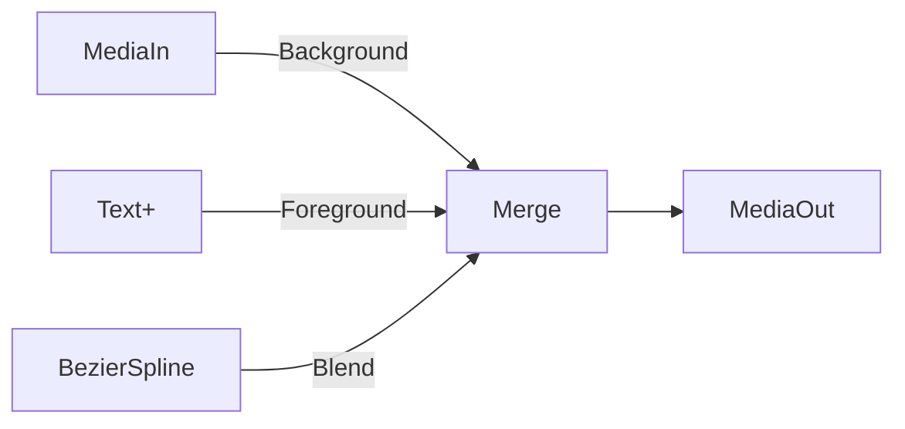
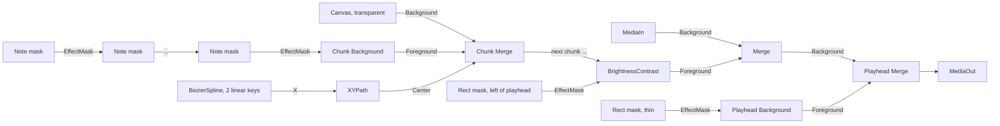

# Fusion VFX prototype — 2 October 2026

The bridge can create a Fusion composition, read its node graph, and add a Text+
lower third with an animated fade. The recipe runs in the authorized Resolve test
project. It uses fixed node types and validated values; a model cannot supply
Python, Lua, expressions, arbitrary nodes, or a general parameter setter.

## What is implemented

- Composition listing and creation on a video clip with no existing composition.
- Normalized graph reads: nodes, input connections, selected parameter values,
  existing expressions, keyframes, and render/global frame ranges.
- A separate graph fingerprint over full copied tool settings and scope. Timeline
  snapshots alone do not cover Fusion edits.
- A frozen lower-third plan with explicit text, position, size and fade length.
- Journaled execution, stale-graph rejection, exact readback and duplicate-request
  protection. Failed attempts remain in the journal for inspection.
- Explicit Fusion-page preparation and page/playhead restoration. The demo also
  restores the original timeline and checks its normalized snapshot.

### Recipe



The default title has two lines, uses Arial Bold at normalized position `(0.5,
0.18)`, and has size `0.065`. Text is limited to 160 characters and two lines.
Position and size have bounded ranges. The 240-frame demo has opacity keys at
frames 0, 12, 227 and 239 with values 0, 1, 1 and 0. Existing source/output nodes
and Resolve's hidden audio-display helpers are preserved except for the planned
output connection. This video-only demo does not play or insert audio.

## Commands

Read compositions without changing timeline selection or playhead:

```bash
python scripts/inspect_fusion.py --project-id PROJECT_ID \
  --timeline-id TIMELINE_ID --clip-id CLIP_ID
```

Add `--comp-name 'Composition 1'` to read that graph. The graph reader can inspect
an inactive timeline. Plans and writes require the target timeline to be active.

Preview a new demo:

```bash
python scripts/fusion_demo.py --project-id PROJECT_ID \
  --media-id SOURCE_MEDIA_ID --run-id UNIQUE_RUN_ID
```

Add `--execute` to create `AI_BRIDGE_TEST_UNIQUE_RUN_ID_VFX` in `AI Bridge / 90 Tests`,
insert source frames `[90, 330)` on V1, build the effect, and verify replay/stale
checks. It briefly changes Resolve's page and playhead and restores them afterward.
Use a source with at least 330 frames that meets the existing append contract.
An existing report for the same run ID is rejected. Inspect failed attempts before
starting a different request.

The command's `verified` status covers the graph and normalized timeline. Its
report explicitly says `visual_verification: not_performed`. Native API success
does not establish that Resolve's timeline output contains the effect. The live
evidence below includes a separate export and visual inspection.

## Live evidence

Environment: Resolve Studio **21.0.0.48**, macOS arm64, Python 3.13.9. Live writes
are pinned to that calibrated Resolve build and `AI_BRIDGE_TEST_` timelines.

- Project: a disposable test project.
- Final demo timeline: `AI_BRIDGE_TEST_20261002_FINAL_VFX`; composition: `Composition 1`.
- The recipe readback verifies Text+, Merge and BezierSpline, exact connections,
  text/font/position/size, four keyframes, and opacity interpolation. Replaying the
  same request preserves the graph. A stale graph fingerprint is rejected.
- The original Timeline 1 snapshot was unchanged afterwards.
  Its active selection, playhead and Edit page were restored after exports.
- The final `.comp` and five 1920×1080 PNG stills were exported and inspected.
  The reports and retained diagnostic specimens are not part of this repository.

The unit suite covers graph scope, stale state, parameter validation, native
serialization failures, unexpected topology, partial writes, replay protection,
host audio helpers, existing locks, and delayed page/playhead readback. These are
mocked checks; the live fixture supplies the actual Resolve evidence.

## Resolve behavior found during testing

1. **A correct graph can still produce plain footage.** Detached graph edits and
   loaded edits wrapped in `Lock`/`Unlock` passed graph checks but failed exported
   frame inspection. The working recipe loads the requested clip on Fusion and
   keeps refresh notifications enabled while editing. It groups edits with
   `StartUndo`/`EndUndo(True)` and rejects an already locked composition.
2. **Loading adds hidden nodes.** Resolve creates `Left` and `Right` AudioDisplay
   helpers connected to MediaIn's `LeftAudio` and `RightAudio`. Only that observed
   helper topology is accepted alongside a simple MediaIn → MediaOut image path.
3. **Merge has an opacity alias.** Adding a Blend modifier also connects
   `BlendClone`. Readback verifies both connections.
4. **Page changes settle asynchronously.** A successful page/timecode setter can
   precede the updated readback. The bridge polls acknowledgment for up to three
   seconds without repeating the mutation. Positioning happens on Edit because
   the installed API does not support `SetCurrentTimecode` on Fusion.
5. **Native serialization needs `OrderedDict`.** On this build, `CopySettings`
   needs `collections.OrderedDict` available in `__main__`. The wrapper otherwise
   prints an error and returns `Tools=None`, which the adapter rejects. Reports
   explicitly use UTF-8 because loading the native library can change the locale.
6. **An empty composition-name list can be `{}`.** It is accepted as empty only
   when the independent composition count is zero.

## Limits

This is one live-tested VFX recipe, plus the MIDI piano roll below, which is
unit-tested only. Custom existing graphs are rejected. No tracking,
roto, keying, particles, arbitrary graph editing, model controller, or render queue
is exposed. Graph fingerprints detect changes but do not make GUI edits atomic.
Every caller must share the same operation journal to serialize bridge writes.
An Undo group preserves a recovery event; it does not automatically roll back a
partial failure. Backup archive integrity is checked; restoring it is untested.

API references: the installed Resolve Developer/Scripting/README.txt and
[Blackmagic's Fusion scripting guide](https://documents.blackmagicdesign.com/UserManuals/Fusion8_Scripting_Guide.pdf).
The older guide's relevant methods were checked against the installed Resolve build.

## MIDI piano roll (5 October 2026, not yet run in Resolve)

A second bounded recipe draws a scrolling piano roll from a `.mid` file over a
test clip. Each note is one Rectangle mask, and its left edge reaches a playhead
line on the exact (sub)frame of its note-on, using the file's tempo map. It is
unit-tested against the fakes only. Nothing here has touched Resolve yet. The
smoke test at the end is how it gets its first live run.

**Parser.** `src/resolve_bridge/midi.py` is a pure-Python port of ae-scripts'
`lib/midi.jsxinc`, which follows MIDI-HERO's `src/midi/parse.ts`. It keeps that
parser's arithmetic order, so note times come out as the same doubles. The test
suite runs the ES3 parser in node on the demo fixture and on every `.mid` in
MIDI-HERO's `public/` and `local-songs/` folders (27 files, 85,041 notes) and
requires identical ticks, times, durations, order, tracks, tempo and meter maps.
It also matches `tools/midi-to-json.js` output. Those tests skip when node or the
two repos are absent. The cross-check found one bug in the port (a sysex length
read in the wrong order), which now has its own regression test.

### Graph



- **Chunks.** A Background covers only the frame, so a long roll is cut into
  chunks one frame-width of music wide (`seconds_visible`, default 6 s). Notes in a
  chunk chain their masks into one Background. A note that crosses a chunk edge is
  drawn as two rectangles; only the first piece carries its note-on. A held note
  is cut where it can no longer reach the screen during the clip.
- **Scroll.** Song time at comp frame f is `start_seconds + (f - render_start)/fps`,
  using the timeline's exact rate. Chunk k's Merge center x is
  `playhead_x + 0.5 + k - (f - render_start)/(fps × seconds_visible)`. That is
  linear in f, so two keys at the render ends with handles a third of the way along
  the line (plus `Flags.Linear`) give constant speed. Tempo changes show as notes
  bunching or spreading, as they sound.
- **Lighting.** A single BrightnessContrast (gain 2) is masked to everything left
  of the playhead. A bar lights the frame its note-on reaches the line and stays
  lit as it scrolls away. Per-note lighting would cost a node per note.
- **Bar markers (optional).** A Purple timeline marker on each bar that starts
  inside the clip and before the music ends, following meter and tempo changes.
  Frames round half up. They're added in the same journal operation after the
  graph verifies. A plan is refused if any bar frame already has a marker.
- **Defaults.** All tracks with drums (channel 10) skipped, rows fitted to the notes
  and padded to an octave, notes from `start_seconds` until the last song time that
  can reach the screen during the clip. Notes that start before `start_seconds`
  are not drawn.

### Caps

Nodes = 7 fixed + 4 per non-empty chunk + 1 per note rectangle. The caps are
**256 nodes, 200 rectangles, 12 chunks, 88 pitch rows and 64 bar markers**. Over a
cap, the plan fails with code `roll_too_large`, the counts, and what to narrow
(time range, one track or channel, pitch range). The ceiling is low because every
graph read walks every input of every node over the scripting bridge. I haven't
measured it, but at tens of native calls per node a 250-node read is probably
seconds, not milliseconds, and the recipe reads the full graph after building.

What fits, at 29.97 fps with defaults, on simple piano arrangements: a 30 s clip
of Twinkle needs 181 nodes (138 notes), Ode to Joy 171, Für Elise 194, The
Entertainer 138. Dense files need one track or a short range: a 10 s clip of
a dense dance track needed 372 nodes and was refused.

### Verification

Execution revalidates the plan (MIDI file SHA-256, layout hash, snapshot, graph
fingerprint), builds inside one Undo group, and then:

- the node set equals the original nodes plus exactly the planned names and types;
- the connection set equals the planned edges (a mismatch reports the first
  missing and unexpected edges);
- every mask's Center/Width/Height, every Background color, the gain, the XYPath Y
  and the spline keys read back within 1e-6;
- existing tools are unchanged apart from MediaOut's input;
- each chunk's Merge center, evaluated at the render ends and mid-clip, matches the
  linear formula, and for up to three notes per chunk the left edge evaluated at the
  note-on frame (fractional) sits on `playhead_x`. An eased spline fails here.
- With bar markers, each marker reads back exactly and nothing else on the
  timeline changed. Without them, the timeline snapshot is unchanged.

The result says `visual_verification: not_performed`, as the lower third does.

### Assumptions the live run must confirm

These are Fusion details I couldn't check without Resolve. Each one fails closed
in verification, except the first, which only a look at the frame can catch.

1. **Mask size units.** Bar heights assume a mask's Width and Height are measured
   in image widths (equal values draw a square) while Center is per-axis. If the
   bars come out squashed or overlapping vertically, set `MASK_SIZE_UNIT` in
   `midi_roll.py` to `"per_axis"` (heights then use frame-height units).
2. **Tool and port IDs:** `RectangleMask` (output `Mask`, input `EffectMask`),
   `Background` (`TopLeftRed/Green/Blue/Alpha`), `XYPath` (inputs `X`, `Y`, output
   `Value`), `BrightnessContrast` (`Gain`).
3. **`AddModifier("Center", "XYPath")`** creates one XYPath and leaves its X
   unanimated, so a second `AddModifier("X", "BezierSpline")` adds exactly one
   spline. An extra auto-created spline would fail the node-set check.
4. **`SetKeyFrames` accepts handles** (`RH`/`LH` as `{1: frame, 2: value}`) and
   `Flags`. If Fusion ignores them and eases, the onset check fails.
5. **`GetPrefs("Comp.FrameFormat.Width")`/`Height`** return the comp's frame size.
6. Chained masks combine by their default paint mode (Merge, a union).
